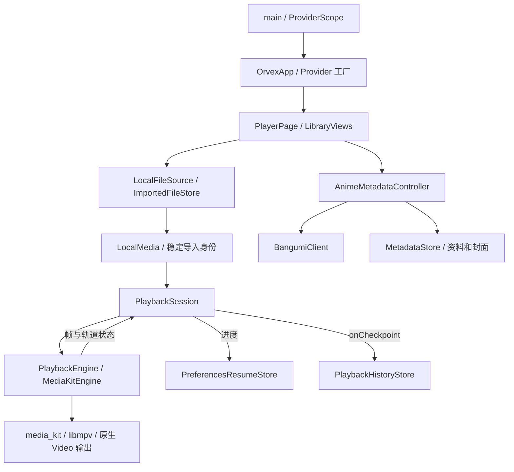

# 当前架构

核对日期：2026-11-06。依据 `lib/`、平台工程、`pubspec.yaml` / `pubspec.lock` 和已保存验证记录；已随文件夹媒体库实现更新。本文复用并替代原 `docs/architecture.md`，不另维护一份早期规划。

## 技术栈与实际版本

应用版本 `0.1.0+1`。SDK 在 `.tooling/flutter`，`scripts/bootstrap-flutter.sh` 固定并核验提交 `c197ca5199e9ee5661e865596c9c07294dfab51c`。`flutterw` 使用该路径，但不在每次执行时重新核验提交。

| 用途 | 当前锁定版本 | 依据 |
| --- | --- | --- |
| Flutter / Dart | 3.47.9 / 3.13.7 | 本地 SDK；Dart 约束为 `^3.13.7` |
| 依赖装配 | flutter_riverpod / riverpod 3.4.3 | `pubspec.lock`、`lib/app/orvex_app.dart` |
| 播放 | media_kit 1.2.6、media_kit_video 2.0.1、media_kit_libs_video 1.0.7 | 锁文件及 `MediaKitEngine` |
| 平台播放依赖包 | iOS 1.1.4、macOS 1.1.4、Android 1.3.8、Windows 1.0.11 | 对应 `media_kit_libs_*_video` Dart 包锁定版本 |
| 文件选择 | file_selector 1.1.0 | `LocalFileSource` |
| 偏好 / 目录 | shared_preferences 2.5.6、path_provider 2.1.6 | 进度、历史、设置、文件缓存 |
| 字幕内容去重 | crypto 3.0.8 | `ImportedFileStore` 的 SHA-256 |
| 静态检查 / 测试 | flutter_lints 6.0.0、SDK 自带 flutter_test / integration_test | `analysis_options.yaml` 和测试目录 |
| 测试偏好实现 | shared_preferences_platform_interface 2.4.2 | dev dependency，用内存实现替换设备偏好 |

上述平台版本是 Dart 包版本；iOS/macOS 的 Podspec/Podfile.lock 将相应原生包报告为 `1.0.4`，不能直接与 Dart 包号比较。Apple 工程有 Flutter 生成的 Swift Package 入口，播放器相关插件仍通过 CocoaPods 接入。

未引入数据库、路由框架、HTTP 客户端包、依赖代码生成或多播放器调度。网络直接使用 `dart:io HttpClient`。

## 目录与职责

| 位置 | 实际职责 |
| --- | --- |
| `lib/main.dart` | 初始化 Flutter、MediaKit，捕获内核启动失败，运行 ProviderScope |
| `lib/app/orvex_app.dart` | Provider 工厂、资源销毁回调、响应式 MaterialApp 主题和根页面 |
| `lib/design/` | 语义颜色/尺寸/排版、局部 Flutter 玻璃材质、外观偏好及局部返回页面栈；实现规范见 DESIGN_SYSTEM |
| `lib/features/player/domain/` | LocalMedia、稳定导入/目录媒体身份、PlaybackFrame/Track、PlaybackEngine、ResumeStore 契约 |
| `player/application/playback_session.dart` | 会话代次、串行命令、订阅/销毁、进度检查点、中断暂停、轻量播放列表和资源授权生命周期 |
| `player/infrastructure/` | media_kit/libmpv 适配；偏好进度读写与旧键迁移；独立的 iOS 显示亮度适配，不改变播放器契约 |
| `player/presentation/` | PlayerPage 应用外壳；WatchInformation 为播放信息与既有动作的纯展示；PlaybackSurface 的控制条、手势和视频展示 |
| `media_sources/` | 原生文件选择、扩展名检查、移动端持久导入、当前目录解析 |
| `library/` | 四模块界面、播放记录模型与最多 100 项本地历史 |
| `library/domain/media_series.dart`、`library/presentation/series_library.dart` | 从既有 LocalMedia 派生名称/季/年份分组，剧集封面及分集列表；文件夹浏览继续使用 FolderBrowser |
| `folder_library/` | 只读目录授权、递归索引、自然排序、缩略图缓存、多级目录与惰性播放列表；复用 LocalMedia |
| `native/apple/` | iOS/macOS 共享书签、目录读取及 AVAssetImageGenerator 适配；原生验证测试 |
| `subtitles/` | 本地字幕引用/选择、完整名称与集数匹配、候选发现、稳定引用与偏好持久化；复用 Imports/FolderAccess，由原 PlaybackSession 调度 |
| `anime_metadata/` | 文件名整理、候选判断、后台匹配、Bangumi API、本地资料/封面缓存、纠正面板 |
| `ios/`、`android/`、`macos/`、`windows/` | 各平台宿主、插件和构建配置；不是四套独立产品实现 |
| `test/` | 单元/界面测试及内存替身、生成素材；目录扫描、身份兼容、缓存和列表规模回归单独覆盖 |
| `integration_test/` / `test_driver/` | 原生播放实验和真实 Bangumi 联网实验；与普通测试分开运行 |
| `scripts/` | 本地 SDK/缓存入口、Android 环境入口、检查、素材与图标生成 |
| `docs/verification/` | 过去的构建、设备、界面及用户验收证据 |

## 状态管理与依赖关系

Riverpod 当前用于创建并提供 `LocalFileSource`、历史存储、`AnimeMetadataController`、`PlaybackSession`，并在作用域销毁时清理资源。它不是所有界面状态的统一容器。

- FolderLibrary、PlaybackSession、AnimeMetadataController 继承 `ChangeNotifier`。
- AppearanceController 同样使用 ChangeNotifier，经 Provider 装配，仅负责 ThemeMode、透明度与系统无障碍偏好；AppearanceScope 与 MaterialApp 响应更新，不替换播放会话。默认 System，选择保存在 `orvex.appearance.theme.v1` / `orvex.appearance.reduce-transparency.v1`。没有新增状态管理框架。
- 字幕恢复/匹配是原 PlaybackSession 的可选 SubtitleSupport 协作：LocalSubtitles 负责文件和偏好，Session 负责串行附着、过期结果与授权释放；不创建第二套播放状态。每视频记忆关闭、手动外挂或内置轨道，自动匹配不覆盖明确选择。
- UI 通过 `ListenableBuilder` 和手动 listener 刷新；选中标签、文件选择中、全屏、搜索、手势等由 `StatefulWidget.setState` 管理。
- 当前未使用 NotifierProvider、Bloc、Redux 或第三方路由包。四个底部入口仍由 PlayerPage 管理；播放详情、剧集分集和独立文件夹浏览使用 Flutter 自带的局部 Navigator 页面栈。`lib/design/back_navigation.dart` 复用 CupertinoPage / MaterialPage 与 NavigatorPopHandler；资料面板继续使用 ModalBottomSheet。
- PlaybackSurface 的控制层独立渐变，视频组件始终保留；拖动/待跳转目标、临时倍速、反馈和菜单状态只保留在当前视图。取消、后台、暂停及引擎切换清理临时状态；恢复倍速前核对引擎身份。键盘事件仅由视频自身焦点处理，输入框、滑块和菜单保留各自行为。
- PlayerPage 同时协调文件选择、存储加载、应用生命周期和导航；LibraryViews 同时包含四模块展示。展示层直接引用部分基础设施和 app Provider，尚未完全解耦。
- 返回使用 UI 层页面历史，不新增媒体身份或持久化历史。底层列表在播放页覆盖时保留，iOS 的交互式返回取消不暂停，确认返回才暂停并保存原会话。全屏仍在同一播放页中替换展示，关闭边缘返回以保留原播放器手势；不会同时挂载两份活动视频。播放页内的目录条保持原地浏览，独立媒体库文件夹页面才逐页保存导航状态。
- PlaybackEngine 契约包含 `Widget buildVideo()`，domain 文件依赖 Flutter widgets；这是轻量契约，不是完全脱离 Flutter 的领域层。

运行链路：

## 本地导入与播放

1. `LocalFileSource` 调用系统文件选择器。iOS 使用宽类型选择，随后校验扩展名；接受 MP4/MKV/MOV/M4V/WebM/AVI/TS，不代表每种编码均已验证。
2. iOS/Android 将文件复制到 Documents/Imports 的独立临时目录：先写 `.part`，校验长度后重命名；失败只清理本次目录。字幕按内容哈希复用；视频复制时流式计算 SHA-256，相同内容复用已有路径/续播身份，同名但不同内容保留。旧视频按需补哈希，不搬迁、不自动删除旧副本。桌面端直接打开选择的文件。
3. LocalMedia 对已导入文件保存相对位置，用稳定键表示身份。打开历史前由 ImportedFileStore 根据当前 Documents 目录解析有效地址；找不到文件时提前报错。
4. PlaybackSession 切换时保存并销毁旧会话，读取续播位置，再创建引擎。先通知界面构建视频表面，再等待原生 open，避免等待初始化时没有视频表面。
5. 引擎把原生状态转为 PlaybackFrame；会话丢弃过期代次的事件，串行执行播放/暂停、跳转、倍速、轨道等命令。
6. 有效时长下，每约 5 秒进度变化、暂停、切换或关闭触发保存；完成后续播位置归零。历史通过 `onCheckpoint` 写入，按最近观看时间排序。

## 文件夹来源与竖屏播放列表

FolderLibrary 不替换 Imports：用户明确添加根目录后只读扫描，使用独立 JSON 索引和相对路径；启动加载索引，手动重新扫描。Apple 保存并恢复书签作用域，Android 使用持久 SAF URI 权限，Windows 使用目录选择和文件系统。NativeFolderAccess、ThumbnailCache 与 UI 分工见 [文件夹设计与边界](folder-library.md)。

LocalMedia 增加可选 folderRoot/folderFile，目录媒体以根 ID/文件 ID 作为稳定进度身份；历史 v2 增加可选字段，已有导入/URI 键保持兼容。可靠系统身份支持同根目录移动/重命名；无法确认时保留旧记录、建立新条目，不按标题或大小合并。

会话准备目录媒体时取得资源租约，先发布原生视频表面再打开，销毁引擎后才释放作用域。当前列表保存在原 PlaybackSession，按稳定身份找到当前索引，提供前后切换和默认关闭的自动下一集。后台/离开播放页禁止自动下一集。浏览文件夹不修改播放上下文。

FolderBrowser 为媒体库和竖屏详情复用多级面包屑、逐层分组、搜索与未播放筛选。详情头部保持视频组件挂载，剧集行惰性构建；宽窗口的 iPad/桌面由 PlayerPage 在右侧列表与原上下布局间切换，沿用同一 FolderBrowser 状态和非全屏视频子树，不改变 PlaybackSession 或引擎。完整文件名与帮助按需打开。Apple/Android 系统缩略图提取与播放解码独立，失败用占位图；Windows 提取未实现。缓存仅处理可见附近请求，最多一个提取任务，磁盘限 128 MiB/2000 张。

媒体库现在默认 SeriesLibrary 剧集视图，可切回文件夹。分组基于规范化片名、集数、季/年份及来源，数字文件名可使用真实目录上下文；同一集的不同文件版本不合并。FolderLibrary 缓存派生分组和身份查找，PlayerPage 在目录索引更新后防抖提交完整媒体集合进行匹配。从剧集或其历史打开时构建该组有序列表，仍由原 PlaybackSession 播放、保存进度。

AnimeMetadataController 默认采用搜索候选首项，同一规范化查询批量完成一组排队项并保存，人工操作按每个媒体代次保护。整组更正一次保存，后续成员可继承人工选择。原已匹配/人工数据保留，旧待确认数据采用原候选重算，无需改变存储格式。大规模候选 JSON 仍按媒体保存，容量和真实大库性能仍需测量。

Apple 原生预览以明确的解码错误触发 MediaKitPreview 补充：一个临时 Player/VideoController、关闭音轨及字幕、短时解码取得实际帧后释放；不使用第二套播放会话，不改主播放器状态。缓存队列仍只运行一个提取任务，列表解码使用原 cacheWidth 限制。权限错误不触发补充；固定上限的 thumbnail-results-v1.json 只记录哈希键、状态与后端，不记录文件名/路径或视频内容。Windows 提取和 Android 补充未验证。

## 播放器与平台差异

- 唯一已接入引擎为 MediaKitEngine。使用 `NativePlayer.setProperty` 配置字体和核对外挂字幕轨道，依赖 libmpv 的具体属性；还不能声称可直接替换任意播放器。
- 原生 libass 渲染外挂字幕；内置静态 Noto Sans CJK SC 字体及 OFL 许可。代码接受 SRT/ASS/SSA/VTT；已保存的原生像素实验重点为 SRT/ASS。
- iOS Swift AppDelegate 的 `dev.orvex/audio-session` 通道负责 AVAudioSession 激活/释放、模拟器识别、音频中断及耳机断开通知。会话收到事件只暂停，不自动继续。
- `PlayerBrightness` 使用独立 `dev.orvex/display` 通道读取/设置 iOS 主屏亮度；首次调整时保存原值，退出播放视图或应用失活时恢复。模拟器、外接屏和其他平台返回不可用或不提供该能力，界面提示使用系统亮度，不显示无效调节控件。iPhone 本轮整体操作已获用户通过反馈，亮度恢复与真实系统事件仍需单独验证；音量仍由已有 PlaybackSession / MediaKitEngine 接口控制，只改变播放器音量，不改变系统音量。
- 新增的 `dev.orvex/appearance` 只在 iOS/macOS 读取并通知减少透明度/动态偏好，不创建原生玻璃视图。当前材质由 Flutter 的 GlassSurface 实现，普通卡片不模糊；播放器覆盖层保留固定沉浸式配色，设置面板随应用主题更新。
- 移动端切后台暂停；长文件导入在后台完成后只进入列表。当前没有后台连续播放能力。
- 全屏通过 media_kit_video 的原生全屏函数；Android MainActivity 和桌面宿主仍以 Flutter 标准入口为主，无项目自定义多引擎实现。
- 当前依赖的 iOS 模拟器二进制无真实音频驱动。`ORVEX_SILENT_SIMULATOR_TEST` 经过原生模拟器检查后才启用 null 输出；真实声音验收必须来自物理设备。

## 持久化与元数据

| 数据 | 当前存储 / 兼容方式 |
| --- | --- |
| 视频/字幕 | Documents/Imports；视频按内容查重，字幕按内容哈希和文件名复用 |
| 续播进度 | SharedPreferences；已导入文件使用稳定的 v2 键，兼容旧绝对路径检查点 |
| 播放记录 | `orvex.history.v2` JSON 字符串列表，最多 100 项；旧 v1 保留作恢复数据 |
| 文件夹授权和索引 | Application Support/folder-library-v1.json，串行临时写入/替换及备份；不包含视频副本 |
| 视频预览 | Application Support/thumbnails-v1，按稳定文件身份与大小/修改时间分版本，磁盘限额清理 |
| 导入查重缓存 | Documents/Imports/.video-hashes-v1.json，相对路径对应大小/修改/变更时间及 SHA-256；可重建，不替代媒体或进度 |
| 自动下一集 | SharedPreferences，默认关闭，当前仅播放页前台允许自动继续 |
| 首页开关 | SharedPreferences；并非完整全局设置模型 |
| Bangumi 资料 | Application Support 下 `bangumi-metadata-v1.json`，含规则版本和人工选择 |
| Bangumi 封面 | 按条目 ID 缓存为 `bangumi-cover-*.img`；内存里重建当前路径 |
| 字幕记忆 / 智能匹配 | `orvex.subtitles.choice.v1.<resumeKey>` / `orvex.subtitles.automatic.v1`；相对 Imports 或授权根 ID + 相对字幕路径，见 [字幕验证](verification/subtitle-memory/README.md) |
| 字幕字体 | Application Support/subtitle-fonts-v2 |

Bangumi 工作独立于播放等待链。按用户最新要求，默认采用返回候选的第一项；已有英文主线关系补充仍在客户端中保留。人工关联/忽略受版本和请求代次保护。HTTP 请求串行、限大小、有超时和 429 冷却。详情见 [Bangumi 接入](bangumi-metadata.md) 与 [本轮验证](verification/series-library/README.md)。

## 工程现状与风险

| 事实 | 对开发的影响 / 后续处理 |
| --- | --- |
| PlayerPage 同时协调播放和片库导航，并与应用入口双向引用；LibraryViews 集中了多个媒体浏览场景 | 播放进度更新期间复用片库快照。若后续拆分，优先把播放帧订阅限制在播放子树，并解除入口的双向依赖，按 L 提案验证导航和会话生命周期 |
| Imports 每次刷新仍全量遍历，但每个视频只异步读取一次文件属性，排序使用已读取的数据 | 文件夹索引和惰性列表已有千项界面测试；真实大文件夹与网络文件提供方的延迟和功耗尚未测量 |
| Apple 目录读取、访问授权和缩略图处理共用串行队列 | 缩略图等待可能延迟文件解析。先测慢速文件提供方下选集和缩略图并发的延迟，再评估如何分离工作并保留授权的有效期 |
| 偏好 JSON、文件 JSON、多个迁移键共同保存状态 | 新增字段/迁移需测试旧数据、完成状态、回退进度和故障；没有数据库事务 |
| MetadataStore 忽略单条坏数据，但整个 JSON 损坏会使加载失败；无缓存清理/容量淘汰 | 可恢复性和长期磁盘占用是明确后续项 |
| 原生 libmpv 属性、音频通道和混合 CocoaPods/SPM 依赖 | 引擎/插件升级必须保留原生实验与设备验收，Dart 测试不够 |
| `pubspec.yaml` 将生成测试视频/字幕列为普通 assets | 测试素材会进入正式包，未来分发前处理资源边界 |
| Android 主 manifest 未显式声明 INTERNET，debug/profile 有声明；macOS Debug/Profile 和 Release 都没有 network.client entitlement | 本轮 macOS 联网封面验证失败，离线外观和原生播放分别验证；尚未修改权限并复验联网。Android 最终合并清单未构建 |
| 无项目级 LICENSE / 第三方分发清单；字体 OFL 已保留 | 对外分发前需明确项目许可及原生二进制、字体、封面来源的分发条件 |

当前平台验证范围、近期任务及尚未实现能力统一维护在 [ROADMAP](ROADMAP.md)。检查命令与协作要求见根目录 [AGENTS](../AGENTS.md)。
