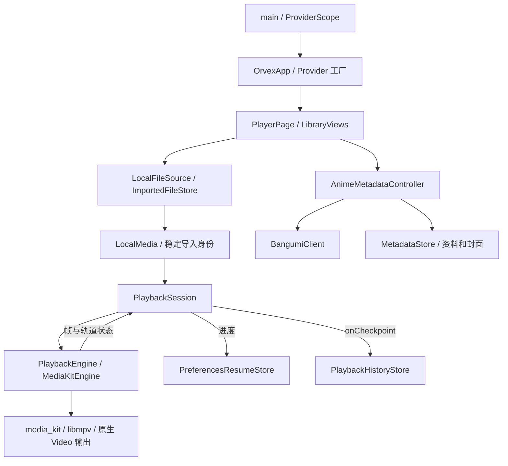

# 当前架构

核对日期：2026-11-06。依据 `lib/`、平台工程、`pubspec.yaml` / `pubspec.lock` 和已保存验证记录；本次只审计和整理文档。本文复用并替代原 `docs/architecture.md`，不另维护一份早期规划。

## 技术栈与实际版本

应用版本 `0.1.0+1`。SDK 在 `.tooling/flutter`，`scripts/bootstrap-flutter.sh` 固定并核验提交 `c197ca5199e9ee5661e865596c9c07294dfab51c`。`flutterw` 使用该路径，但不在每次执行时重新核验提交。

| 用途 | 当前锁定版本 | 依据 |
| --- | --- | --- |
| Flutter / Dart | 3.47.9 / 3.13.7 | 本地 SDK；Dart 约束为 `^3.13.7` |
| 依赖装配 | flutter_riverpod / riverpod 3.4.3 | `pubspec.lock`、`lib/app/orvex_app.dart` |
| 播放 | media_kit 1.2.6、media_kit_video 2.0.1、media_kit_libs_video 1.0.7 | 锁文件及 `MediaKitEngine` |
| 平台播放依赖包 | iOS 1.1.4、macOS 1.1.4、Android 1.3.8、Windows 1.0.11 | 对应 `media_kit_libs_*_video` Dart 包锁定版本 |
| 文件选择 | file_selector 1.1.0 | `LocalFileSource` |
| 偏好 / 目录 | shared_preferences 2.5.6、path_provider 2.1.6 | 进度、历史、设置、文件缓存 |
| 字幕内容去重 | crypto 3.0.8 | `ImportedFileStore` 的 SHA-256 |
| 静态检查 / 测试 | flutter_lints 6.0.0、SDK 自带 flutter_test / integration_test | `analysis_options.yaml` 和测试目录 |
| 测试偏好实现 | shared_preferences_platform_interface 2.4.2 | dev dependency，用内存实现替换设备偏好 |

上述平台版本是 Dart 包版本；iOS/macOS 的 Podspec/Podfile.lock 将相应原生包报告为 `1.0.4`，不能直接与 Dart 包号比较。Apple 工程有 Flutter 生成的 Swift Package 入口，播放器相关插件仍通过 CocoaPods 接入。

未引入数据库、路由框架、HTTP 客户端包、依赖代码生成或多播放器调度。网络直接使用 `dart:io HttpClient`。

## 目录与职责

| 位置 | 实际职责 |
| --- | --- |
| `lib/main.dart` | 初始化 Flutter、MediaKit，捕获内核启动失败，运行 ProviderScope |
| `lib/app/orvex_app.dart` | Provider 工厂、资源销毁回调、主题和根页面 |
| `lib/features/player/domain/` | LocalMedia、稳定导入身份、PlaybackFrame/Track、PlaybackEngine、ResumeStore 契约 |
| `player/application/playback_session.dart` | 会话代次、串行命令、订阅/销毁、进度检查点、中断暂停 |
| `player/infrastructure/` | media_kit/libmpv 适配；偏好进度读写与旧键迁移 |
| `player/presentation/` | PlayerPage 应用外壳；PlaybackSurface 的控制条、手势和视频展示 |
| `media_sources/` | 原生文件选择、扩展名检查、移动端持久导入、当前目录解析 |
| `library/` | 四模块界面、播放记录模型与最多 100 项本地历史 |
| `anime_metadata/` | 文件名整理、候选判断、后台匹配、Bangumi API、本地资料/封面缓存、纠正面板 |
| `ios/`、`android/`、`macos/`、`windows/` | 各平台宿主、插件和构建配置；不是四套独立产品实现 |
| `test/` | 8 个单元/界面测试文件及内存替身、生成素材 |
| `integration_test/` / `test_driver/` | 原生播放实验和真实 Bangumi 联网实验；与普通测试分开运行 |
| `scripts/` | 本地 SDK/缓存入口、Android 环境入口、检查、素材与图标生成 |
| `docs/verification/` | 过去的构建、设备、界面及用户验收证据 |

## 状态管理与依赖关系

Riverpod 当前用于创建并提供 `LocalFileSource`、历史存储、`AnimeMetadataController`、`PlaybackSession`，并在作用域销毁时清理资源。它不是所有界面状态的统一容器。

- PlaybackSession、AnimeMetadataController 继承 `ChangeNotifier`。
- UI 通过 `ListenableBuilder` 和手动 listener 刷新；选中标签、文件选择中、全屏、搜索、手势等由 `StatefulWidget.setState` 管理。
- 当前未使用 NotifierProvider、Bloc、Redux，也没有独立路由系统；四个底部入口和播放视图在 PlayerPage 中切换，资料面板使用 ModalBottomSheet。
- PlayerPage 同时协调文件选择、存储加载、应用生命周期和导航；LibraryViews 同时包含四模块展示。展示层直接引用部分基础设施和 app Provider，尚未完全解耦。
- PlaybackEngine 契约包含 `Widget buildVideo()`，domain 文件依赖 Flutter widgets；这是轻量契约，不是完全脱离 Flutter 的领域层。

运行链路：

## 本地导入与播放

1. `LocalFileSource` 调用系统文件选择器。iOS 使用宽类型选择，随后校验扩展名；接受 MP4/MKV/MOV/M4V/WebM/AVI/TS，不代表每种编码均已验证。
2. iOS/Android 将文件复制到 Documents/Imports 的独立临时目录：先写 `.part`，校验长度后重命名；失败只清理本次目录。字幕按内容哈希复用；视频重复导入保留不同副本。桌面端直接打开选择的文件。
3. LocalMedia 对已导入文件保存相对位置，用稳定键表示身份。打开历史前由 ImportedFileStore 根据当前 Documents 目录解析有效地址；找不到文件时提前报错。
4. PlaybackSession 切换时保存并销毁旧会话，读取续播位置，再创建引擎。先通知界面构建视频表面，再等待原生 open，避免等待初始化时没有视频表面。
5. 引擎把原生状态转为 PlaybackFrame；会话丢弃过期代次的事件，串行执行播放/暂停、跳转、倍速、轨道等命令。
6. 有效时长下，每约 5 秒进度变化、暂停、切换或关闭触发保存；完成后续播位置归零。历史通过 `onCheckpoint` 写入，按最近观看时间排序。

## 播放器与平台差异

- 唯一已接入引擎为 MediaKitEngine。使用 `NativePlayer.setProperty` 配置字体和核对外挂字幕轨道，依赖 libmpv 的具体属性；还不能声称可直接替换任意播放器。
- 原生 libass 渲染外挂字幕；内置静态 Noto Sans CJK SC 字体及 OFL 许可。代码接受 SRT/ASS/SSA/VTT；已保存的原生像素实验重点为 SRT/ASS。
- iOS Swift AppDelegate 的 `dev.orvex/audio-session` 通道负责 AVAudioSession 激活/释放、模拟器识别、音频中断及耳机断开通知。会话收到事件只暂停，不自动继续。
- 移动端切后台暂停；长文件导入在后台完成后只进入列表。当前没有后台连续播放能力。
- 全屏通过 media_kit_video 的原生全屏函数；Android MainActivity 和桌面宿主仍以 Flutter 标准入口为主，无项目自定义多引擎实现。
- 当前依赖的 iOS 模拟器二进制无真实音频驱动。`ORVEX_SILENT_SIMULATOR_TEST` 经过原生模拟器检查后才启用 null 输出；真实声音验收必须来自物理设备。

## 持久化与元数据

| 数据 | 当前存储 / 兼容方式 |
| --- | --- |
| 视频/字幕 | Documents/Imports；字幕哈希去重，视频独立副本 |
| 续播进度 | SharedPreferences；已导入文件使用稳定的 v2 键，兼容旧绝对路径检查点 |
| 播放记录 | `orvex.history.v2` JSON 字符串列表，最多 100 项；旧 v1 保留作恢复数据 |
| 首页开关 | SharedPreferences；并非完整全局设置模型 |
| Bangumi 资料 | Application Support 下 `bangumi-metadata-v1.json`，含规则版本和人工选择 |
| Bangumi 封面 | 按条目 ID 缓存为 `bangumi-cover-*.img`；内存里重建当前路径 |
| 字幕字体 | Application Support/subtitle-fonts-v2 |

Bangumi 工作独立于播放等待链。唯一规范化标题/别名可自动匹配，歧义留给用户；缺失英文别名时，满足严格条件才通过两个以上独立条目的明确主线关系补充识别。人工关联/忽略受版本和请求代次保护。HTTP 请求串行、限大小、有超时和 429 冷却。详情见 [Bangumi 接入](bangumi-metadata.md)。

## 工程现状与风险

| 事实 | 对开发的影响 / 后续处理 |
| --- | --- |
| PlayerPage 530 行、LibraryViews 1091 行；职责较集中且有跨层直接引用 | 下一次较大功能先说明职责边界，必要时按 L 提案；本轮不拆分 |
| 文件列表全量递归扫描，排序调用 statSync；界面用 Wrap 构建网格 | 大片库性能尚未验证，不能用小样本流畅推断规模表现 |
| 偏好 JSON、文件 JSON、多个迁移键共同保存状态 | 新增字段/迁移需测试旧数据、完成状态、回退进度和故障；没有数据库事务 |
| MetadataStore 忽略单条坏数据，但整个 JSON 损坏会使加载失败；无缓存清理/容量淘汰 | 可恢复性和长期磁盘占用是明确后续项 |
| 原生 libmpv 属性、音频通道和混合 CocoaPods/SPM 依赖 | 引擎/插件升级必须保留原生实验与设备验收，Dart 测试不够 |
| `pubspec.yaml` 将生成测试视频/字幕列为普通 assets | 测试素材会进入正式包，未来分发前处理资源边界 |
| Android 主 manifest 未显式声明 INTERNET，debug/profile 有声明；macOS Release 无 network.client entitlement | 恢复相应平台工作时核验发布联网配置；本轮未构建最终 Android 合并清单或做 macOS 发布联网验收 |
| 无项目级 LICENSE / 第三方分发清单；字体 OFL 已保留 | 对外分发前需明确项目许可及原生二进制、字体、封面来源的分发条件 |

当前平台验证范围、近期任务及尚未实现能力统一维护在 [ROADMAP](ROADMAP.md)。检查命令与协作要求见根目录 [AGENTS](../AGENTS.md)。
