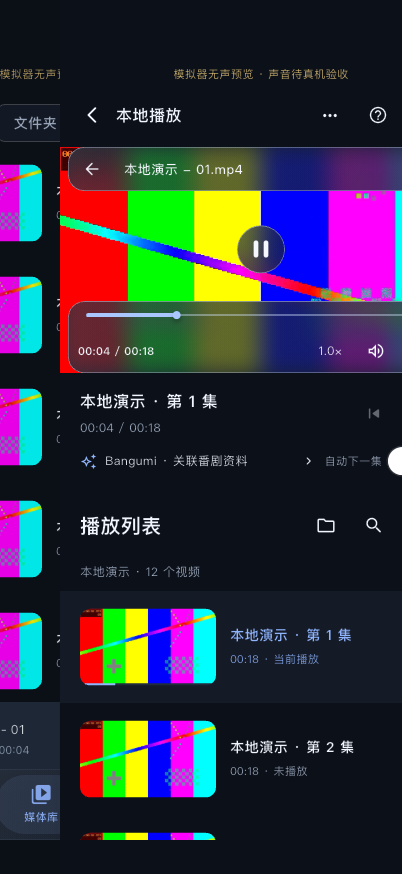
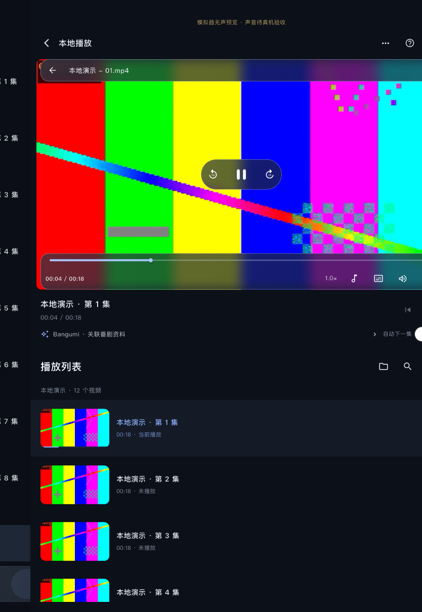

# 层级返回与 iOS 边缘手势

日期：2026-11-06。本轮为现有界面补充返回历史，不改存储、媒体身份、文件导入、解码引擎或 PlaybackSession 接口，不新增依赖。

## 原因与实现

原先 PlayerPage 在同一个根页面中用布尔值切换播放视图，SeriesLibrary 切换海报/分集，FolderBrowser 原地替换目录。没有可弹出的页面，根 PopScope 又阻止播放时退出，因此无法获得 Cupertino 页面内置的交互式返回。

现在 `lib/design/back_navigation.dart` 用 Flutter 自带 Navigator 页面栈、CupertinoPage / MaterialPage 和 NavigatorPopHandler 承载已有层级。它是 Flutter 的平台适配实现，**不是新增 UIKit 原生桥接**；也未接入路由包或第二套产品状态管理。

- 播放详情返回实际进入播放前的页面，保留底部模块、所选剧集/目录、列表滚动与筛选。
- 分集页返回剧集总览；独立“文件夹”模式记录访问过的目录页面，可以逐页返回。面包屑选择已在历史中的祖先时退至该层，不反复复制同一页。
- 四个底部模块仍是同级入口，不将切换标签记为返回历史；没有上一层时边缘滑动不会退出 App。
- Bangumi 等模态面板保留原有下滑/关闭与系统返回行为。
- 播放页内目录条仍是原地浏览，不为每次切目录叠加另一份视频。全屏在同一播放页内切换，继续保留既有退出全屏入口/系统返回，关闭页面边缘弹出，避免抢占播放手势。

iOS 的拖动、跟手动画、速度/距离阈值及取消回弹直接复用 Cupertino 页面。参考 [Apple 手势原则](https://developer.apple.com/design/human-interface-guidelines/gestures)、[Flutter CupertinoPage](https://api.flutter.dev/flutter/cupertino/CupertinoPage-class.html)、[PopScope 对 iOS/Android 的区别](https://api.flutter.dev/flutter/widgets/PopScope-class.html)。没有把“任意横滑即返回”的监听器盖在播放器上。

## 播放与输入边界

- 完成返回才调用原有暂停/进度检查点；取消拖动仍保持播放，媒体引擎不重建。
- 返回时立即撤销自动下一集许可并隐藏播放页；较晚到达的媒体变化不能重新打开已退出的页面。显式点开视频/返回当前播放时才重新显示。
- 视频页面关闭快照过渡，避免返回交互只显示冻结的视频截图；底层媒体列表保持挂载，状态由原控制器提供。
- 路由底色统一采用语义背景与 Material，保证明暗主题、背景衔接和 ListTile 点击反馈。
- Android 使用系统返回分发到最内层页面，未用自定义边缘手势代替系统返回。
- macOS / iPad 外接键盘支持 `⌘[`，Windows/Linux 支持 `Alt+←`，支持导航返回键和鼠标返回侧键。文本编辑时不截获键盘返回快捷键；一次鼠标事件只由最深活动页面处理，避免一按退两层。Esc 等既有播放器键仍由播放器处理。

## 验证

| 范围 | 结果 |
| --- | --- |
| `./scripts/check` | Passed：格式、静态分析与 105 项普通测试，见 [日志](checks.log) |
| iOS 界面测试 | 短拖取消、完成拖动、播放页→分集→总览、根页不退出、引擎/进度保持；文件夹逐层返回与父页搜索保存 |
| Android 界面测试 | 系统返回事件依次退出播放、分集，应用根仍保留；不是 Android 原生设备或预测返回动画验收 |
| 桌面界面测试 | macOS/Windows 快捷键、输入中不抢键；嵌套页面鼠标返回一次只退最深一层 |
| iPhone 18 Pro 模拟器 / iOS 27.2 | 原生 libmpv 播放生成视频；视频区域左边缘短拖跟手并取消后仍播放，完整拖动后暂停并回到原分集及滚动位置，再返回总览；重新进入同一视频续播且只创建过一个会话引擎；全屏左边缘横滑仍留在播放器。明暗画面及 [日志](iphone.log)、[状态记录](iphone-observations.json) |
| iPad 模拟器 / iOS 27.2 | Passed：与 iPhone 同一入口验证短拖跟手/取消继续播放、完成返回暂停、原滚动位置、分集→总览、续播及全屏不被边缘返回截获；[日志](ipad.log)、[状态记录](ipad-observations.json) |
| 正式入口构建 | iOS Release（未签名）通过，`lib/main.dart` 且不含 Orvex 测试/代理参数；[构建日志](ios-release-build.log)、[摘要](ios-release-build-summary.json) |
| 尚未验证 | 本轮物理 iPhone/iPad、真实声音/系统中断、Android/macOS/Windows 原生宿主、Android 预测返回动画、长时间多层目录浏览的内存及进程恢复均为 Not Tested |

测试只在 isSimulator 校验成功后创建隔离临时文件和偏好，不在物理设备导入生成素材；未清理用户媒体。底层目录索引、存储键与恢复逻辑不变。目录页面历史只保留在内存，未增加导航恢复格式。

## 运行画面

画面来自实际模拟器，使用生成测试视频，不是用户片源。Flutter 窗口截图包含安全区背景，不包含 SpringBoard 的时钟/电池图形。

| iPhone 跟手拖动 | iPad 跟手拖动 |
| --- | --- |
|  |  |

iPhone：[取消后继续播放](iphone-edge-cancelled-dark.png)、[返回原滚动位置](iphone-returned-series-scroll-dark.png)、[分集页](iphone-returned-series-dark.png)、[总览](iphone-returned-library-light.png)、[全屏不退出](iphone-fullscreen-edge-remains-player.png)。

iPad：[取消后继续播放](ipad-edge-cancelled-dark.png)、[返回原滚动位置](ipad-returned-series-scroll-dark.png)、[分集页](ipad-returned-series-dark.png)、[总览](ipad-returned-library-light.png)、[全屏不退出](ipad-fullscreen-edge-remains-player.png)。

```bash
./scripts/check
./scripts/flutterw test integration_test/back_navigation_test.dart \
  -d 0D043D06-A86D-44E7-A32A-B72FDCC30299 --no-pub --no-uninstall \
  --dart-define=ORVEX_SILENT_SIMULATOR_TEST=true
./scripts/flutterw test integration_test/back_navigation_test.dart \
  -d 139B061B-ED02-4594-A56A-1AAC3A7AF574 --no-pub --no-uninstall \
  --dart-define=ORVEX_SILENT_SIMULATOR_TEST=true
```

初次实现阶段未安装物理设备。用户随后明确授权后续功能完成后自动下发，已写入 AGENTS.md；本次返回手势版已沿用原团队签名，覆盖安装并启动于 iPhone 17 Pro Max 和 iPad Pro 2022。正式入口/签名/设备包含检查通过，无模拟器实验或代理参数；没有卸载、清空、真机生成素材实验、提交或推送。安装/启动不是功能验收，见 [下发摘要](device-install-launch.json)、[签名构建日志](ios-signed-device-build.log)。
