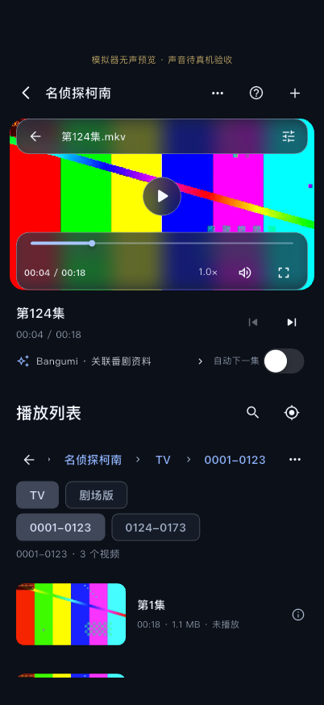

# 文件夹媒体库与竖屏详情：本轮结果

日期：2026-11-06。实现边界见 [folder-library](../../folder-library.md)，能力状态仍以 [ROADMAP](../../ROADMAP.md) 为主。没有新依赖、播放器更换、用户源文件移动/删除/整目录复制、签名变更、开发验收阶段的物理设备安装、提交或推送。用户随后明确要求安装至 iPad，已完成覆盖安装和启动，见下方记录。

## 真实运行画面

下方截图来自实际模拟器运行，目录为原生测试创建后经正式扫描器读取的真实多级文件夹，不是写死的生产数据。视频均为项目生成的 18 秒测试样片；`.mkv` 名称的文件内容仍是 MP4，不能声称测试了真正的 MKV。

| iPhone 浅色 | iPhone 深色，浏览另一分组而不换片 |
| --- | --- |
|  |  |

- iPhone：[目录](iphone/directory-light.png)、[分组](iphone/group-light.png)、[深色详情](iphone/portrait-dark.png)、[下一集](iphone/next-episode-dark.png)、[全屏](iphone/fullscreen.png)、[内核解码帧](iphone/decoded-frame.png)。
- iPad：[目录](ipad/directory-light.png)、[分组](ipad/group-light.png)、[浅色详情](ipad/portrait-light.png)、[深色详情](ipad/portrait-dark.png)、[其他分组](ipad/browse-other-group-dark.png)、[下一集](ipad/next-episode-dark.png)、[全屏](ipad/fullscreen.png)。

## 已执行

| 检查 | 结果和范围 |
| --- | --- |
| `./scripts/check` | Passed；47 个文件格式无改动、analyze 无问题、83 项普通测试；[日志](checks.log) |
| 真实临时目录与身份 | Passed；核心七文件样例、自然顺序、符号链接循环、路径边界、索引重载、新增/删除、取消、子目录失败、可靠 ID 移动、无可靠 ID 不猜测合并；历史根/文件身份兼容 |
| 播放会话与缓存 | Passed；下一集、自动下一集前台限制、过期授权释放、引擎先销毁再释放目录、磁盘复用/限额/版本失效/授权恢复重试；单个提取任务 |
| 1000 项界面 | Passed；明暗主题、惰性构建、定位第 500 项、浏览不切片、较大文字 1.7 倍与 360 宽界面无溢出。是界面测试，不是千视频解码或真实大片库性能结论 |
| Apple 原生目录接口 | Passed；iPhone/iPad 模拟器、macOS。真实书签创建/恢复、目录读取、链接跳过、路径拒绝、AVAssetImageGenerator 帧及正确释放；[iPhone](native-iphone.txt)、[iPad](native-ipad.txt)、[macOS](native-macos.txt) |
| iPhone / iPad 原生播放 UI | Passed；一次索引根目录得到七文件；层级/当前目录两集；真实预览与 libmpv 画面、跳转、下一集、历史上下文、明暗主题、滚动/浏览/全屏保持同一个引擎。返回全屏后测试显式请求竖屏再操作；[iPhone 日志](iphone-integration.log) / [结果](iphone/results.txt)，[iPad 日志](ipad-integration.log) / [结果](ipad/results.txt) |
| 正式入口构建 | Passed；`lib/main.dart` 的 iOS Release 未签名包和 macOS Debug，无模拟器无声/代理/测试入口参数；[iOS](ios-release-build.log)、[macOS](macos-build.log) |

最后一个扫描优化只将旧记录按路径/可靠身份预先建表，避免每个新文件遍历全部旧索引；修改后再次运行完整 83 项检查及正式入口构建。没有通过删除测试、忽略错误或关闭检查使其通过。

## 后续 iPad 安装

按用户“安装至 ipad”授权，沿用原个人团队，正式 Release 重新签名构建，确认描述文件包含 iPad、正式入口没有 Orvex 测试参数、codesign 校验通过。已在连接的 iPad Pro 2022（11 英寸，第 4 代）覆盖安装，并由 devicectl 确认启动成功；没有卸载、清除数据或运行生成媒体实验。[安装摘要](ipad-device-install-launch.json)、[签名构建日志](ios-signed-build.log)。

这只证明 Installed / Launched；文件选择、外部授权恢复、声音、字幕和播放交互仍待用户自备媒体验收。

## 尚未验证和已知限制

- **物理 iPhone/iPad：Not Tested。** 本轮没有向物理设备导入生成素材。需要用户自备片库验证系统“文件”选择、外部授权、重启恢复、声音、字幕和真实格式。
- **外部文件提供方：Not Tested。** 原生测试使用 App 自有实际目录生成书签，再在新适配器和新的 Flutter 应用启动中恢复；没有自动点击原生目录选择器取得 Files/iCloud/第三方提供方授权，不能把内部目录书签通过写成所有外部提供方通过。
- Apple 的系统提取器拒绝本轮 `.mkv` 文件名，界面显示占位；同一文件由 libmpv 实际播放成功。真实 MKV、复杂编码、4K/HDR、网络挂载和长片预览仍需覆盖。时长未知时不伪造时长，播放后使用实际帧/历史时长。
- iOS 模拟器显式使用 null 音频输出，**声音和物理亮度 Not Tested**。既有字幕/手势单元测试仍通过；本轮未新增真实字幕/声音像素或人工听音实验。
- macOS 本轮有正式构建、原生书签/预览测试，完整文件夹 UI/播放器新回归 **Not Tested**；不把此前 macOS 播放实验写成本轮全功能通过。既有出站网络权限问题仍未修复。
- Android SAF 适配已写入代码，但本机没有 Android SDK，**编译/运行 Not Tested**。Windows 目录适配 **Not Tested**，Windows 缩略图提取尚未实现；都不能宣称交付验证通过。
- 无可靠文件身份时，不猜测重命名/跨根目录移动，可能产生新媒体身份；旧进度仍保留。部分提供方没有可信大小/修改时间时，同一身份的内容改写不能可靠检测，仍需增强版本信号。
- 扫描按目录异步工作；取消会丢弃过期结果并保留旧索引，需要等待当前系统读取返回。未验证断网/离线云文件提供方的最坏等待时间。真实大片库滚动、磁盘占用、功耗和后台恢复是后续设备工作。
- 材质仍是 Orvex 的 Flutter 玻璃实现，不是原生 Liquid Glass。列表没有逐行模糊；减少动态/透明度沿用既有设计系统与自动测试，不增加装饰性动画。

## 排查中出现过的问题

1. 首次原生测试在尚未启动的测试引擎上注册消息处理器失败。改为测试专用 messenger，仅替代通道，不替代文件系统/书签/视频提取；正式 Flutter 集成仍走实际宿主通道并通过。
2. 首次集成把 `.mkv` 提取成功当作前提而失败。保留该不支持分支，另要求真正 `.mp4` 文件提取成功，确认 MKV 占位不阻止播放；没有把缩略图失败屏蔽成成功。
3. 全屏退出后测试设备仍横屏，测试点击画面外的“下一集”失败。改为真实切回竖屏并滚动到按钮再点击，不关闭命中检查；引擎连续性仍有断言。
4. macOS 原生测试的旧 TEST_HOST 使用小写 `orvex`，实际产品名是 `Orvex`。仅修正测试宿主路径，原生测试随后通过。
5. 后续 Xcode 原生检查曾继承 Flutter 集成测试临时入口，临时文件被清理后构建失败。重跑时显式指定 `lib/main.dart` 和空测试参数，正式包也独立重新构建通过。

## 复现

```bash
./scripts/check

# 先核对为 iOS 模拟器，原生测试同样拒绝物理 iOS 设备。
# 该测试在 App 自有目录准备真实生成样片和书签，供下一条集成测试使用。
xcodebuild -workspace ios/Runner.xcworkspace -scheme Runner \
  -configuration Debug -destination 'id=IOS_SIMULATOR_ID' \
  -parallel-testing-enabled NO -only-testing:RunnerTests/MediaFolderAccessTests \
  FLUTTER_TARGET="$PWD/lib/main.dart" DART_DEFINES= test

# Xcode 可能结束后关闭模拟器，先通过 simctl/Simulator 启动同一设备。
./scripts/flutterw test integration_test/folder_library_test.dart \
  -d IOS_SIMULATOR_ID --no-pub --no-uninstall \
  --dart-define=ORVEX_SILENT_SIMULATOR_TEST=true

# macOS 原生接口（不是完整新 UI 的运行验收）。
xcodebuild -workspace macos/Runner.xcworkspace -scheme Runner \
  -configuration Debug -destination 'platform=macOS' \
  -only-testing:RunnerTests/MediaFolderAccessTests \
  FLUTTER_TARGET="$PWD/lib/main.dart" DART_DEFINES= test

./scripts/flutterw build ios --release --no-codesign --no-pub --target lib/main.dart
./scripts/flutterw build macos --debug --no-pub --target lib/main.dart
```

测试只在自有测试目录写入生成样片、索引和缓存；正式入口不自动注册样例根目录或导入这些数据。未将书签 JSON、个人媒体或私有偏好放入本证据目录。
