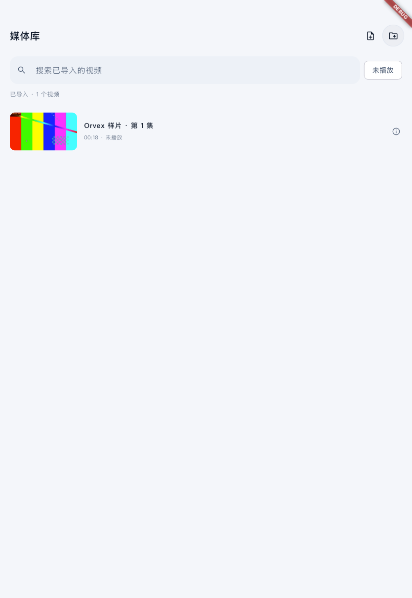
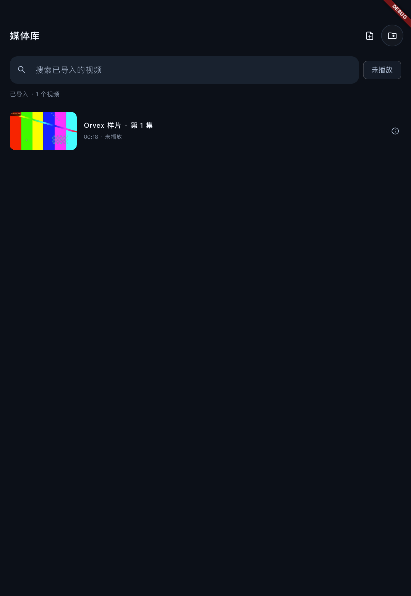

# 已导入单集：重复导入与预览修复

日期：2026-11-06。用户在 iPad 验收中反馈重复导入、封面空白；本次只修复对应链路，不换播放器、不增加依赖、不清理既有副本或历史。

## 原因与行为

- 视频导入原来直接生成随机副本目录。现在在复制时流式计算 SHA-256，只对相同大小候选核对完整内容；相同内容复用已有 LocalMedia、路径与续播键。本次临时目录清理，同名但不同内容保留。
- Imports/.video-hashes-v1.json 是可重建加速缓存，按文件大小、修改/变更时间验证；旧文件按需补哈希，坏缓存可重建，不迁移历史，不搬动旧文件。首次校验旧候选仍需要读取视频，大文件不是零等待/零临时空间。
- 缩略图原来只给 FolderEntry 请求，已导入单集直接返回。现经 ImportedFileStore 解析当前应用目录，走原生 `thumbnailImported`，只接受 Imports 下的相对路径；复用原提取器、单任务队列和 128 MiB/2000 图限额。
- 图片缓存可选 `.duration` 保存实际时长，并随图片淘汰；旧无时长缓存继续可读。加载和不可提取显示不同状态。MKV 等系统不支持的格式依旧可能占位，不能声称本轮修复了所有格式截帧。

## 验证

| 检查 | 结果 |
| --- | --- |
| 完整 `./scripts/check` | Passed：格式、analyze、88 项普通测试；[日志](checks.log) |
| 导入回归 | Passed：相同内容/不同名称、重新创建存储实例、并发重复请求、旧无哈希文件与坏缓存、改写使旧哈希失效、同名同大小不同内容不合并、失败局部清理、旧路径重定位 |
| 缓存回归 | Passed：单集稳定身份/容器路径变化键、图片及时长复用、文件修改版本失效、文件丢失提示；原目录缓存取消/失败重试/限额及播放会话测试保留 |
| iPad 模拟器 | Passed：实际 Imports 视频重复选择不增加数量，真实 AVAssetImageGenerator 提帧、JPEG 解码、列表 Image 显示、深浅主题和缓存时长；[日志](ipad-simulator.log)、[结果](results.txt) |
| 正式构建 | Passed：[macOS Debug](macos-build.log)、[iOS 签名 Release](ios-signed-build.log)，`lib/main.dart` 无 Orvex 测试参数 |
| 物理 iPad Pro 2022 | Installed / Launched：原团队、设备描述文件与 codesign 校验通过，覆盖安装并启动，无卸载/清空/生成视频导入；[摘要](ipad-install.json)。真实视频效果待用户确认 |
| Android / Windows | Not Tested；Android 原生分支已接相对路径，SDK 未安装；Windows 提取仍未实现 |

## 实际画面

这是真实 iPad 模拟器列表与生成样片截帧，没有使用用户视频。界面实验独立于正式 App，截图的 Debug 标记不进入正式 Release。

| 浅色 | 深色 |
| --- | --- |
|  |  |

## 测试适配与限制

- 加载图新增旋转指示后，原千项界面测试等待真实文件 IO 与 FakeAsync 动画时钟产生 pumpAndSettle 超时。该测试专门测惰性布局，现在显式注入确定性无预览缓存；实际文件 IO/提帧由普通缓存测试及模拟器集成覆盖，没有取消布局/滚动/定位断言。
- 原视觉集成的三个文件使用相同样片字节，按新规则应去重。改为明确准备“旧版已存在的独立副本”，继续覆盖三个元数据案例与旧数据兼容；新导入去重由本轮独立集成检查。没有把重新复制当成生产去重通过。
- 物理设备不运行生成素材实验，仅覆盖安装正式 App。此前已经产生的重复文件暂不自动删除、合并或改动播放记录；本轮阻止后续新增相同内容。
- SHA-256 校验需要文件 IO；当前没有导入空间预检。Bangumi 作品海报链路没有改动；本轮修复的是单集列表的视频预览帧。

复现：

```bash
./scripts/check
# 仅限已核对的 iOS 模拟器，入口包含运行时模拟器断言。
./scripts/flutterw test integration_test/imported_media_test.dart \
  -d IOS_SIMULATOR_ID --no-pub --no-uninstall
```
