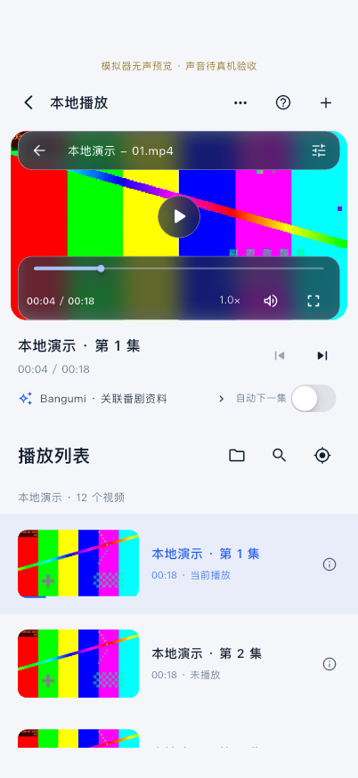
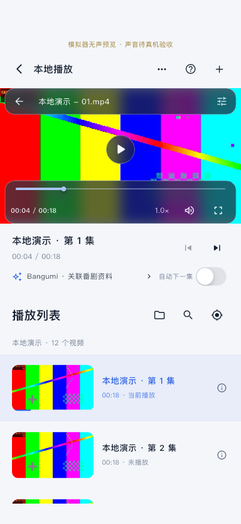
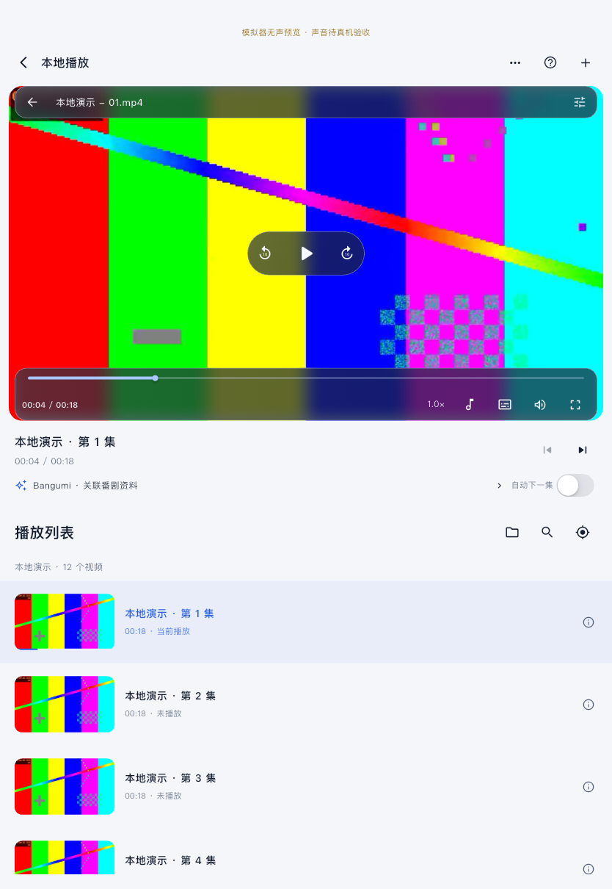

# 播放详情页边界与窗口布局修复

日期：2026-11-06。本轮只修改 `PlayerPage` 布局与全屏系统栏样式，不改播放器引擎、导入、媒体库数据或播放会话。初次布局验证仅在模拟器运行；随后按用户“下发至 iphone 和 ipad”授权完成两台物理设备的覆盖安装与启动，未提交或推送。

## 实际原因与边界

- `MaterialApp` 的两套主题已经将 `scaffoldBackgroundColor` 设为语义 background；普通页面只有一层根 Scaffold，背景位于 SafeArea 外。没有发现包住整个 App 的额外黑色容器、根页面大圆角或全页固定外边距。明暗主题的修改前/后截图四角像素均与当前背景一致（[采样记录](background-samples.json)），也没有复现一圈全局黑框，不能把用户真机上的所有外围黑框都归因于 Theme/SafeArea。
- 能确认的割裂来自 `_watchPage` / `_player`：所有窗口固定左右 12 点视频边距、18 点圆角，外层最大宽度 1100；视频高度完全按 16:9 宽度计算，短横屏窗口里容易放不下完整播放器。
- 视频内部黑底来自 `PlaybackSurface` 和 media_kit 的 contain 显示，属于画面宽高比适配。保留它，未拉伸、裁切或更改解码。
- 全屏此前继承应用明暗系统栏样式；现增加全屏局部深色样式，退出后恢复根主题的样式。

## 修改

入口：`lib/features/player/presentation/player_page.dart`。

- 根 Scaffold 显式使用当前语义背景；保留它在 SafeArea 外铺满整个窗口的结构，状态栏/Home Indicator 区域与页面同色。文字、按钮、列表与播放器控制仍遵守安全区域。
- 可用宽度小于 600 时，视频取消外侧边距与圆角；宽窗口保留 12 点间距，至少 1000 时使用 20 点，圆角减到 10。手机/分屏与平板根据当前窗口宽度适配。
- iOS/iPadOS 页面使用实际窗口宽度，不套桌面的 1100 最大页面宽度。桌面原有阅读宽度保留。
- 视频始终维持 16:9 展示框，宽度同时受当前可见高度约束，视频框最高 700 点；短横屏会减小视频框并居中，周围显示页面主题背景。片源继续由现有 Video contain 适配。
- 保留可滚动详情、原有悬浮控制和列表。没有创建第二个播放会话；主题、全屏和窗口变化不重新创建媒体引擎。

## 检查与限制

| 检查 | 结果 |
| --- | --- |
| `./scripts/check` | Passed：格式、静态分析及 99 项普通测试；[日志](checks.log) |
| 窗口/安全区回归 | 同一会话在手机竖/横屏、平板竖/横屏、430×800、600×480 及恢复尺寸下检查；明暗两套主题、16:9、视频可见范围、按钮安全区和全窗口 Scaffold 均通过 |
| iPhone 18 Pro 模拟器 / iOS 27.2 | 实际 402×874 → 874×402 → 402×874；明暗主题、竖屏详情、横屏非全屏、全屏、滚动/返回顶部通过；[日志](phone-after.log)、[几何记录](phone-after-observations.json) |
| iPad 模拟器 / iOS 27.2 | 原生 834×1210 下明暗主题、竖屏详情、全屏及滚动通过；系统没有响应横屏限制请求，名称为 landscape 的截图仍是竖屏，不能计为原生旋转通过。见 [日志](ipad-after.log)、[几何记录](ipad-after-observations.json) |
| iPad 横屏/窗口尺寸渲染 | 在实际运行的 iPad 模拟器内，额外覆盖 Flutter 视口为 1210×834、430×800、600×480，检查两套主题、横向全屏与恢复。它只验证 Flutter 布局适配，不是 OS 级 Split View、Stage Manager 或真实旋转验收 |
| 播放连续性 | 原生 libmpv 打开生成样片、实际解码/播放并跳到约 4 秒。上述切换中创建计数始终 1、引擎对象一致、进度保留，最后恢复播放并确认进度继续增长，再在持续播放中往返全屏，确认 playing 状态和引擎身份保持 |
| 尚未验证 | iPad OS 级横竖屏/分屏/可调窗口操作、物理 iPhone/iPad、真实声音、不同宽高比/编码的完整覆盖、Android/Windows/macOS 本轮运行与性能均为 Not Tested |

本轮未新增依赖或修改原生配置。已有插件 Swift Package Manager 提示仍保留，没有用忽略检查消除它。

## 后续真机下发

沿用既有个人团队、原 bundle ID 和自动签名，正式 `lib/main.dart` Release 构建及签名校验通过；确认两台设备均包含在描述文件中，正式包未包含 Orvex 模拟器实验或代理参数。iPhone 17 Pro Max、iPad Pro 2022（11 英寸，第 4 代）均覆盖安装和启动成功。没有卸载、清空或运行真机生成素材实验；此结果不代表用户真实片源的布局/声音/交互验收。见 [下发摘要](device-install-launch.json)、[构建日志](ios-signed-build.log)。

## 修改前后真实运行截图

样片为本地生成测试素材，仅在已核对的 iOS 模拟器运行，没有读取用户视频。下列为真实 Flutter 画面截取，包含窗口安全区背景，但不含 SpringBoard 绘制的时钟/电池/Home Indicator 图形。另存原生 App 窗口截图，亦不将其当成 SpringBoard 系统栏完整验收。

| 设备 | 修改前·浅色 | 修改后·浅色 |
| --- | --- | --- |
| iPhone |  |  |
| iPad |  |  |

深色：[iPhone 前](phone-before-portrait-dark.png) / [后](phone-after-portrait-dark.png)，[iPad 前](ipad-before-portrait-dark.png) / [后](ipad-after-portrait-dark.png)。

iPhone：[横屏浅色](phone-after-landscape-light.png)、[横屏深色](phone-after-landscape-dark.png)、[全屏](phone-after-fullscreen-dark.png)、[恢复竖屏](phone-after-portrait-restored.png)、[原生窗口](phone-after-portrait-native-window.png)。

iPad：[横向视口](ipad-after-resized-1210-dark.png)、[小窗口视口](ipad-after-resized-430-light.png)、[更矮窗口](ipad-after-resized-600-dark.png)、[横向视口全屏](ipad-after-resized-landscape-fullscreen-dark.png)、[恢复窗口](ipad-after-window-restored.png)、[原生窗口](ipad-after-portrait-native-window.png)。这些 resized 图片明确属于尺寸模拟。

## 重现命令

```bash
./scripts/check
./scripts/flutterw test integration_test/player_layout_test.dart \
  -d 0D043D06-A86D-44E7-A32A-B72FDCC30299 --no-pub --no-uninstall \
  --dart-define=ORVEX_SILENT_SIMULATOR_TEST=true
./scripts/flutterw test integration_test/player_layout_test.dart \
  -d 139B061B-ED02-4594-A56A-1AAC3A7AF574 --no-pub --no-uninstall \
  --dart-define=ORVEX_SILENT_SIMULATOR_TEST=true
```

修改前在同一入口增加 `--dart-define=ORVEX_LAYOUT_STAGE=before`，只保存基线竖屏画面。测试入口运行前核对原生 isSimulator，再创建临时视频与隔离偏好；正式入口不包含测试模式/代理。不在物理设备运行本入口。
