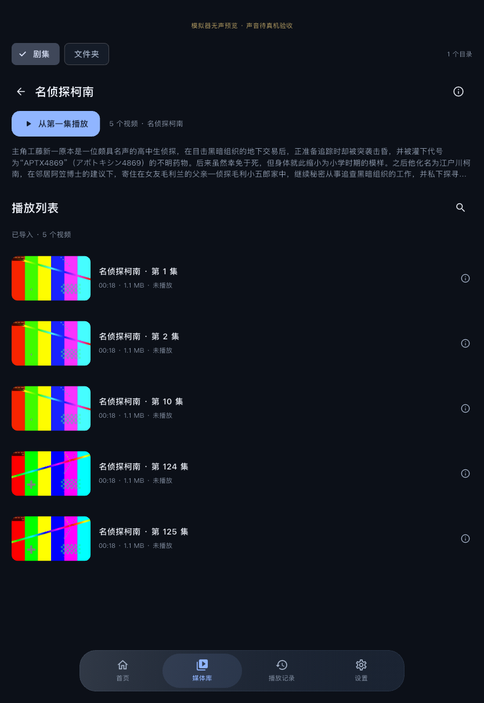

# 名称剧集归类与 Bangumi 默认首项

日期：2026-11-06。用户要求：扫描本地文件后按名字归类成剧集，自动匹配 Bangumi，默认选择第一个候选。保留真实文件夹，不移动、改名或复制扫描来源。

## 本轮行为

- 媒体库默认“剧集”，可切回“文件夹”。文件名提取出的片名、季、年份、集数与来源构成派生分组；只有数字/集数时尝试真实目录名和季目录。无法确定作品的文件保留独立条目。
- 同一作品的分集可跨范围子目录汇总，按集数及自然顺序排列；不同季/年份/来源分开。不同文件版本保留，不按 Bangumi ID 合并真实文件。
- 扫描结果更新后自动提交媒体集合。同一规范化片名共享一次查询，批量保存匹配；候选非空就关联返回的第一项，空结果/联网失败不隐藏文件。第一项不保证是正确作品，可在资料入口手动更正整组或取消关联。
- 整组更正一次写入，新的同组文件继承已有人工选择；旧人工、已匹配及文件进度身份保留，旧待确认候选可直接采用首项。无数据库/存储方案迁移。
- 点海报看分集，点分集播放；有序队列包含跨目录的同组视频，返回保留所选剧集。播放页可切回真实文件夹浏览，不因切换浏览而换片。

## 已执行的检查

| 范围 | 结果 |
| --- | --- |
| 完整 scripts/check | Passed；98 项普通测试，格式和静态分析通过；[日志](checks.log) |
| 分组 | 字幕组/清晰度标签、四位集数、自然顺序、多版本、季/年/来源隔离、纯集数与目录季上下文均覆盖 |
| 匹配 | 首个候选策略、每片名一次查询、大小写/标点归一、旧待确认离线采用、整组人工选择/继承、旧人工覆盖异步结果、失败重试及查询改名时拒绝旧异步结果均覆盖 |
| 界面 | 手机/iPad 尺寸、明暗主题、1.7 倍文字、分组后打开排序队列及返回分集列表覆盖；此前 1000 项文件列表回归仍保留 |
| iPad 模拟器端到端 | Passed：原生书签扫描七个真实生成文件，五集跨范围目录汇成一部，两个独立文件不混入；真实 Bangumi API 的首项为 899，同组五集采用该项，仅查询一次并下载真实封面。点击第 124 集后队列含五集，下一集为 125，目录浏览及返回状态通过；[日志](ipad-simulator.log)、[结果](results.txt) |
| 正式构建 | iOS 签名 Release、macOS Debug；日志见 [iOS](ios-signed-build.log)、[macOS](macos-build.log) |
| 物理 iPad | 正式版覆盖安装；启动状态见 [安装摘要](ipad-install.json)。新分组和匹配仍需用户重新选择真实来源后验收 |
| Android / Windows | 本轮 Not Tested；不声称全平台通过 |

最后对季目录、大小写查询归一、查询改名时的异步结果和操作范围文案做了局部补充，之后再次运行完整检查和正式构建。端到端图片来自实际运行；其中详情按钮和列表小文案随后调整为实际首集编号及剧集名，不代表用户真实视频内容。

## 运行截图

样片为生成测试视频；海报来自实际 Bangumi API。两个电影占位文件名只有“剧场版1/2”，首项可能关联到不相关作品，正说明用户选择的默认首项策略仍需要人工更正入口；没有将其写成语义识别准确率通过。

| 浅色剧集页 | 深色分集页 |
| --- | --- |
|  |  |

另见 [深色总览](series-dark.png)、[播放页](series-player-dark.png)、[原目录模式](folders-dark.png)。模拟器播放使用明确测试参数，声音不作为物理设备验收；正式入口不包含代理或无声测试参数。

## 范围与限制

- 没有更改原文件、导入身份、续播键或播放器引擎；归类不是文件移动或内容去重。
- 无法从名字/目录确定作品时不会把所有文件硬合并为一部；根目录太泛、名称不完整、特别篇/剧场版与别名混用仍需后续样本完善。
- 大片库真实磁盘/功耗与所有字幕组命名未覆盖。候选缓存仍按媒体保存，没有借本任务迁移数据库。
- 用户明确取消了此前数据恢复，不再保留那次偏好备份；本次没有再次执行数据清理。相关已披露事件与实际 MKV 修复证据保留在 [预览记录](../mkv-preview/README.md)。
