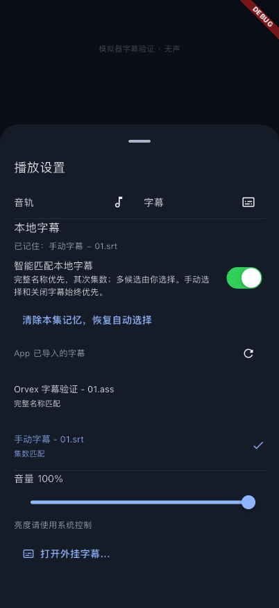
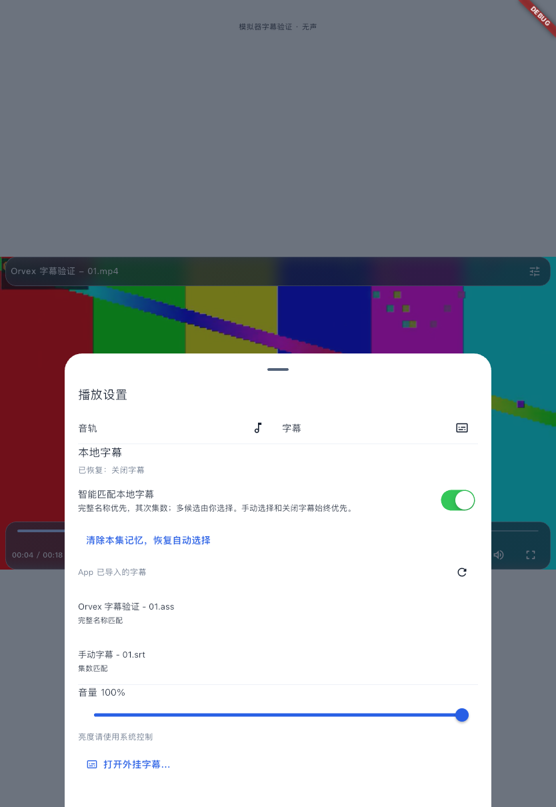

# 本地字幕选择记忆与智能匹配

日期：2026-11-06。用户要求：重开 App 后恢复手动外挂字幕，同文件夹优先完整名称、其次集数匹配，并保留用户选择。沿用现有 media_kit/libmpv、播放会话和文件授权适配器，无新依赖、数据库迁移或原生桥接。

## 已实现行为

- 按视频稳定身份分别记住手动外挂字幕、关闭字幕和手动选择的内置轨道。下次打开同一文件恢复；同名不同视频副本不合并。字幕只有成功加载后才覆盖上次成功的记忆。
- 没有手动选择时，默认开启本地匹配：去扩展名后的完整名称 → 去常见语言后缀后的名称 → 集数。支持现有文件名解析、纯数字集号、四位集数；明确不同的 Sxx 季号不混配。一个最高优先级候选才自动加载，同优先级多候选不猜测语言或格式。
- **授权扫描目录的视频**只读取视频所在直接文件夹中的 SRT/ASS/SSA/VTT，不递归搜索子目录，不把字幕加入视频索引。按需读取，所以无需重新扫描整个媒体库才发现新增字幕。
- **单独导入的视频**在 App 已导入的字幕中匹配。iOS 单文件选择器交回临时副本，原文件夹没有随视频一同授权，不能声称可以访问其原始相邻文件。需要真实同文件夹匹配时应从“添加媒体文件夹”授权根目录。
- “播放设置 → 本地字幕”显示加载/恢复结果、匹配理由、候选及失败信息；可手动更换、重扫、关闭智能匹配，或清除本集记忆恢复自动选择。候选列表最多展示前 20 项，其余保留系统“打开外挂字幕”入口。
- “关闭字幕”按本视频记忆，不会被自动匹配重新打开；全局智能匹配开关只影响没有手动指定的自动模式，手动外挂/内置选择仍优先。取消文件选择不修改记忆。
- 手动文件失效时保留旧记忆并提示重选，不静默换成另一个候选。读设置失败、文件访问/格式失败与保存失败均有反馈，视频继续播放。

旧版只保存了字幕文件，没有视频与字幕关联记录，无法追溯任意旧手选关系。旧字幕文件仍可参加名称/集数匹配；名字无法匹配时需再手选一次，之后开始记住。没有搬迁或删除旧媒体/字幕。

## 实现与兼容

- `features/subtitles/domain/`：字幕引用、选择模式、候选和匹配规则；`infrastructure/local_subtitles.dart`：SharedPreferences、Imports 和 FolderAccess 的文件操作。
- 新键 `orvex.subtitles.choice.v1.<video.resumeKey>` 保存每视频选择；`orvex.subtitles.automatic.v1` 保存全局智能匹配。现有历史、续播和目录索引格式不变。
- App 导入字幕只保存 `Imports/...` 相对路径；授权目录字幕保存 root ID、相对路径和可用的文件身份，不把 iOS 容器绝对路径当持久引用。桌面手选字幕也复制到 App 自有目录以便恢复。
- PlaybackSession 沿用原会话代次和串行命令；发现/准备文件异步执行，附着字幕前检查当前会话与用户操作代次。换片、关闭、手动关闭/更换后，旧结果不能覆盖新选择。原生实际轨道回调提供选中状态，没有乐观伪造轨道 ID。
- 目录授权在播放引擎持有外部字幕时保持，退出/切片时先销毁引擎，再释放所有字幕授权，最后释放视频授权。过期准备结果立即释放。
- mpv 默认会独立按文件名自动加载外部字幕，因此设置 `sub-auto=no`，由本次策略统一控制外部匹配；内置轨道和 libass 渲染保持。依据 [mpv 官方选项](https://github.com/mpv-player/mpv/blob/master/DOCS/man/options.rst)，没有更换引擎或修改其接口。

## 实际验证

| 检查 | 结果 |
| --- | --- |
| `./scripts/check` | Passed：格式、静态分析及 129 项普通测试；[日志](checks.log) |
| 文件匹配与存储 | 7 项：全名/语言/集数优先级、多候选、四位/数字集号、季号冲突、同目录边界/符号链接、旧导入字幕、Documents 移动、不同视频副本隔离、设置持久化/迟到读取、损坏记录与无效路径 |
| 会话与设置 UI | 自动/手动/关闭/内置优先级、不同同名字幕轨道、取消过期发现/准备、失败不覆盖记忆、保存失败提示、授权释放顺序；小屏幕明暗设置页可选择、关闭智能匹配和恢复自动 |
| iPhone 18 Pro 模拟器 | remember / restore 两次独立进程运行均 Passed；重新安装测试入口后 App 容器变化，原手动 SRT 自动恢复且渲染像素相同。直接授权目录全名/集数匹配、关闭记忆和授权释放通过；[首次](iphone-remember.log)、[重启后](iphone-restore.log) |
| iPad 模拟器 | 相同两阶段验证均 Passed；[首次](ipad-remember.log)、[重启后](ipad-restore.log) |
| 原生字幕画面 | libass 截图与同一暂停帧关闭字幕后比较：手动/重启恢复 SRT 各改变底部 3658 像素，同目录 SRT 改变 2987 像素；[iPhone 记录](iphone-remember-results.json)、[重启记录](iphone-restore-results.json)、[iPad 记录](ipad-restore-results.json) |
| 真实声音、外部文件提供方、所有字幕格式/编码、Android/macOS/Windows 原生宿主 | 本轮 Not Tested；模拟器显式无声，不能外推为声音或全平台验收 |

两阶段入口运行的是实际 PlaybackSurface、PlaybackSession、LocalSubtitles、Imports、Apple 目录授权与 libmpv，不是第二套演示实现。使用生成视频/字幕，仅允许 isSimulator 成功后创建夹具。目录案例使用之前原生 MediaFolderAccessTests 生成的 App 自有书签夹具，不能外推为 Files/iCloud 等提供方授权通过。跨进程恢复使用真实原生偏好，两台均实际检测到 Documents 容器路径变化；关闭字幕的再次恢复另通过重建播放会话验证。

## 运行画面

以下为真实播放器组件的模拟器画面，使用生成测试片源；不是用户视频，也不是完整首页截图。字幕内容由 libass 实际渲染。

| iPhone：手选字幕与记忆 | iPad：重启后的关闭记忆 |
| --- | --- |
|  |  |

另见 [iPhone 字幕画面](iphone-remember-manual-video-dark.png)、[同目录集数匹配](ipad-remember-folder-episode-light.png)、[重启后关闭状态](iphone-restore-remembered-off-dark.png)。

```bash
./scripts/check
# 仅允许明确核对的 iOS 模拟器；先有原生目录测试生成的书签夹具。
./scripts/flutterw test integration_test/subtitle_memory_test.dart \
  -d <simulator-id> --no-pub --no-uninstall \
  --dart-define=ORVEX_SILENT_SIMULATOR_TEST=true \
  --dart-define=ORVEX_SUBTITLE_TEST_PHASE=remember
# 另一次启动，读取上一次真实偏好与文件，而不是复用内存中的选择。
./scripts/flutterw test integration_test/subtitle_memory_test.dart \
  -d <same-simulator-id> --no-pub --no-uninstall \
  --dart-define=ORVEX_SILENT_SIMULATOR_TEST=true \
  --dart-define=ORVEX_SUBTITLE_TEST_PHASE=restore
```

## 真机下发

按既有授权完成正式 `lib/main.dart` 签名 Release 构建，签名校验通过，描述文件包含两台设备，包内没有 Orvex 模拟器/代理/测试参数。iPhone 17 Pro Max 与 iPad Pro 2022 均已覆盖安装、启动成功。未卸载、清空或向真机导入生成素材；真实片源/字幕的效果仍待用户反馈。见 [安装摘要](device-install-launch.json)、[签名构建日志](ios-signed-build.log)。
