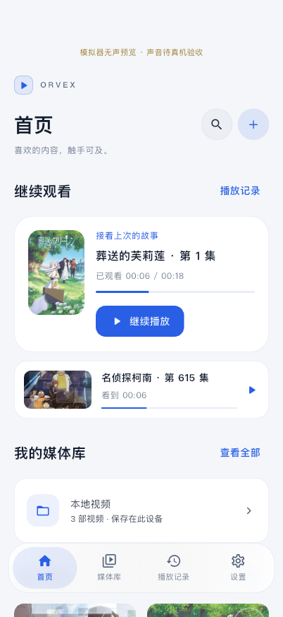
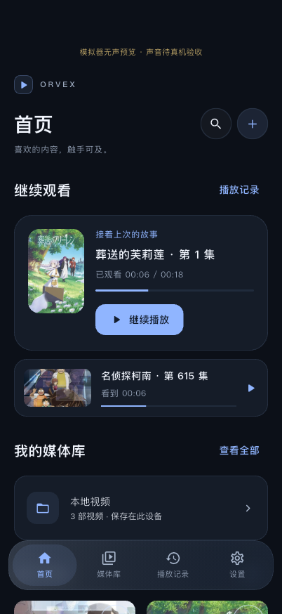

# 首轮视觉升级：实现与实际验证

日期：2026-11-06。视觉规范和技术选择见 [DESIGN_SYSTEM](../../DESIGN_SYSTEM.md)。本轮保留已有播放/导入/历史逻辑，只新增外观偏好与小型 Apple 无障碍设置通道；核心文件对照见 [scope-check.json](scope-check.json)，依赖及锁文件未变，没有新 UI 插件。

## 真实运行截图

以下是测试应用在实际模拟器/桌面运行后导出的画面，没有绘制静态假 UI。视频是项目生成样片，目录与观看记录属于测试；iPhone/iPad 封面和资料来自实际 Bangumi API。它们不代表真实番剧视频播放，不包含用户媒体。

| 浅色 | 深色 |
| --- | --- |
|  |  |

- iPhone：[媒体库浅色](iphone/library-light.png) / [深色](iphone/library-dark.png)、[资料浅色](iphone/details-light.png) / [深色](iphone/details-dark.png)、[外观设置浅色](iphone/settings-light.png) / [深色](iphone/settings-dark.png)、[记录](iphone/history-dark.png)、[播放控制](iphone/player-fullscreen.png)、[播放设置](iphone/player-settings.png)、[减少透明度](iphone/reduced-transparency.png)。
- iPad：[浅色首页](ipad/home-light.png)、[深色首页](ipad/home-dark.png)、[媒体库](ipad/library-dark.png)、[全屏控制](ipad/player-fullscreen.png)。
- macOS Profile：[浅色首页](macos/home-light.png)、[深色首页](macos/home-dark.png)、[设置](macos/settings-dark.png)、[全屏控制](macos/player-fullscreen.png)。此组为离线测试，使用真实本地样片和中性缺图占位，**没有联网封面通过结论**。初始桌面窗口为 800×600；宽窗口侧栏另由 1200 宽度界面测试覆盖。

## 已执行的检查

| 检查 | 结果 | 证据及范围 |
| --- | --- | --- |
| `./scripts/check` | Passed | 39 个文件格式检查 0 改动，analyze 无问题，71 项测试通过；[日志](check.log) |
| 新增外观测试 | 9 项 Passed | 默认 System、持久化与重开、较晚读取不覆盖新选择、系统明暗变化、播放引擎/进度保留、减少透明/动态、高对比度、桌面侧栏、小横屏与 1.3 倍文字；`test/design_system_test.dart` |
| iPhone 18 Pro 模拟器 | Passed | 明暗五页、真实封面、资料、实际继续播放、播放中换主题、主机偏好写入、透明度降级；[结果](iphone/results.txt)；显式无声模式 |
| Orvex iPad Preview 模拟器 | Passed | 同上，平板布局、播放和全屏；[结果](ipad/results.txt)；显式无声模式 |
| 原有原生播放回归 | iPhone 模拟器 / macOS Passed | 继续使用 `native_playback_test.dart`：实际画面、暂停、连续跳转、双音轨、SRT/ASS 渲染及去重、倍速、全屏、续播、重复中断暂停和四模块返回。生成素材不在物理 iPhone 运行 |
| macOS Debug 离线视觉 | Passed | 真实本地播放、明暗页面、外观持久化、引擎不重建、透明度降级；联网故障单列如下 |
| macOS Profile 离线视觉 | Passed | [结果](macos/results.txt)、[时序](macos/frame-timings.txt)、[命令日志](macos-profile.log)；仅省略本地调试服务地址 |
| macOS 正式入口 Debug | Built / Launched | [构建](macos-app-build.log)；目标 `lib/main.dart`、无 ORVEX/集成测试参数，已启动 Orvex.app，便于直接体验 |
| iOS 真机目标 Release | Built | [构建](ios-release-build.log)；目标 `lib/main.dart`，`--no-codesign`，未在本轮覆盖物理设备 |
| 用户后续授权 iPhone 安装 | Installed / Launched | 按“实际安装至 iPhone”授权，沿用原个人团队签名 Release，签名校验、覆盖安装与启动成功；[签名构建](ios-signed-build.log)、[安装摘要](device-install-launch.json)。未卸载或清除数据，无模拟器无声/测试参数；新视觉仍待用户验收 |
| 用户后续授权 iPad 安装 | Installed / Launched | iPad Pro 2022（11 英寸，第 4 代）；用户开启开发者模式后，使用原个人团队将设备纳入描述文件，目标设备 Release 构建、签名校验、安装及启动成功；[摘要](ipad-device-install-launch.json)。正式入口无测试参数，未卸载/清除数据或导入生成素材；视觉与播放仍待用户验收 |
| 新 UI 物理 iPhone/iPad、Android、Windows | Not Tested | 前一轮 iPhone 操作验收保持有效历史，不外推为新 UI 的真机验收。Android/Windows 未构建或运行 |

## macOS 联网失败与界限

首次运行联网视觉测试时，50 秒内未获得全部匹配和封面，命令实际失败，见 [失败日志](macos-network-failure.log)。检查发现 Debug/Profile 只有网络 server 权限，Release 同样没有 `com.apple.security.network.client`；[Apple 对该授权的定义](https://developer.apple.com/documentation/bundleresources/entitlements/com.apple.security.network.client)是允许向外建立网络连接。

本轮未修改联网授权、替换网络实现、关闭检查或把该失败改写为成功。随后明确使用 `ORVEX_VISUAL_NETWORK=false`，自动匹配关闭，验证离线外观、占位、主题与真实播放；这不验证 Bangumi 联网。权限修复及修复后的网络复验仍是独立后续任务。

## 材质与性能

当前是 Flutter 玻璃风格材质，不是原生 Liquid Glass，没有真实折射；只在导航或播放三个局部控件区显式启用裁剪模糊，海报与内容列表不逐卡模糊。减少透明效果/系统相关无障碍设置启用时，使用实色并移除过滤器；运行时断言验证了这一点。

macOS Profile 本机采集 590 帧，构建耗时 p50 0.506ms / p95 2.98ms，栅格化 p50 1.147ms / p95 2.447ms。样本包含换主题、导航、截图和原生视频初始化，使用 640×360 生成样片且不联网。它是本轮场景的观察，不是通用帧率保证；不能证明 4K/HDR、复杂字幕、长时间功耗、低端设备或手机性能通过。

Profile `flutter drive` 输出 integration_test 原生结果收集插件提示，但测试与 driver 均返回成功；结果、截图及 FrameTiming 由测试自身保存。现有播放器插件 SPM 提示与 CocoaPods 宏警告未通过更换依赖或屏蔽检查处理。

## 复现入口

```bash
./scripts/check

# 必须是已核对的 iOS 模拟器，测试自身还会检查；代理仅供测试。
./scripts/flutterw test integration_test/visual_system_test.dart \
  -d IOS_SIMULATOR_ID --no-pub --no-uninstall \
  --dart-define=ORVEX_SILENT_SIMULATOR_TEST=true \
  --dart-define=ORVEX_BANGUMI_TEST_PROXY=127.0.0.1:7892

# macOS 离线视觉测试，不证明联网能力。
./scripts/flutterw test integration_test/visual_system_test.dart \
  -d macos --no-pub --dart-define=ORVEX_VISUAL_NETWORK=false
./scripts/flutterw drive --profile --no-pub \
  --driver=test_driver/integration_test.dart \
  --target=integration_test/visual_system_test.dart \
  -d macos --dart-define=ORVEX_VISUAL_NETWORK=false

# 正式应用入口；不使用测试参数。
./scripts/flutterw build macos --debug --no-pub --target lib/main.dart
open build/macos/Build/Products/Debug/Orvex.app
```

下一轮优先检查 iPhone/iPad 真机的新视觉、横竖屏、亮度/音量操作及辅助功能；补 macOS 出站网络授权并复验，再做更大素材库和移动设备性能验证。启动器图标、真实折射与系统原生材质仍未在本轮实现。
